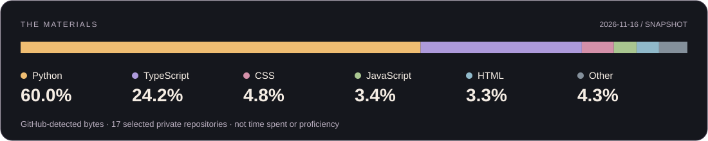

<!-- Generated from profile.json by scripts/render_profile.py. -->

<picture>
  <source media="(prefers-color-scheme: light)" srcset="assets/workshop-light.svg">
  
</picture>

# AI agents. Security systems. Useful tools.

I build agentic AI systems, data-protection workflows, and the tools that connect them. My work spans Python backends, TypeScript interfaces, retrieval pipelines, and browser automation.

[Explore the workbench](#on-the-workbench) · [See the materials](#languages-on-the-workbench) · [Static artwork](assets/workshop-static-dark.svg)

## On the workbench

Most of my work lives in private repositories. Here is a window into what I build.

### 01 / Guard + govern

**Certificate management and crypto agility**

Bringing certificate management, cryptographic assessment, and AI-assisted operations into one platform, with a Python API and a React interface.

`Python` · `TypeScript` · `FastAPI` · `React`

### 02 / Reason + act

**Agents for security and data protection**

LLM-guided browser exploration, retrieval-backed security assistants, and role-aware data protection workflows. I work on the path from finding evidence to taking a useful next step.

`Python` · `JavaScript` · `Playwright` · `Pinecone`

### 03 / Connect + create

**MCP tools with tangible outputs**

Tools that turn an agent's work into Word reports and Excel workbooks, with file delivery through cloud storage. Small interfaces that make automation useful beyond the chat window.

`JavaScript` · `Node.js` · `MCP` · `Supabase`

## Languages on the workbench

<picture>
  <source media="(prefers-color-scheme: light)" srcset="assets/languages-light.svg">
  
</picture>

Read the numbers and how they are measured

| Language | Share of detected bytes |
| --- | ---: |
| Python | 60.0% |
| TypeScript | 24.2% |
| CSS | 4.8% |
| JavaScript | 3.4% |
| HTML | 3.3% |
| Other | 4.3% |

Snapshot: **2026-11-16** · **17 selected private repositories**. Shares use GitHub's detected language bytes. They do not measure proficiency or time spent. Similar code in different repositories can be counted more than once. Small languages are grouped as Other. Percentages are rounded.

## Tools I work with

`FastAPI` · `React` · `Playwright` · `MCP` · `LangChain` · `CrewAI` · `Pinecone` · `Supabase`

Elsewhere in the workshop

- Exploring memory and knowledge sharing across agent crews.
- Building retrieval pipelines for regulatory framework evidence.
- Experimenting with LLM guardrails for sensitive input and prompt injection.

---

**The thread through it all:** turning complex systems into tools people can use.

Hand-drawn in SVG. Built from a curated snapshot of my work. <a href="https://github.com/SanthoshSamudrala009">Find me on GitHub</a>.
