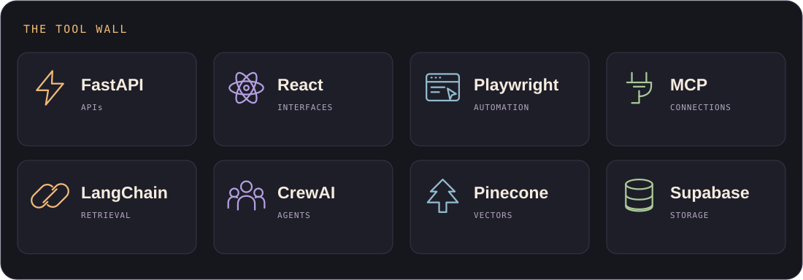

<!-- Generated from profile.json by scripts/render_profile.py. -->

<picture data-panel="workshop">
  <source media="(max-width: 600px) and (prefers-color-scheme: light)" srcset="assets/workshop-mobile-light.svg">
  <source media="(max-width: 600px)" srcset="assets/workshop-mobile-dark.svg">
  <source media="(prefers-color-scheme: light)" srcset="assets/workshop-light.svg">
  
</picture>

<picture data-panel="projects">
  <source media="(max-width: 600px) and (prefers-color-scheme: light)" srcset="assets/projects-mobile-light.svg">
  <source media="(max-width: 600px)" srcset="assets/projects-mobile-dark.svg">
  <source media="(prefers-color-scheme: light)" srcset="assets/projects-light.svg">
  
</picture>

<picture data-panel="toolkit">
  <source media="(max-width: 600px) and (prefers-color-scheme: light)" srcset="assets/toolkit-mobile-light.svg">
  <source media="(max-width: 600px)" srcset="assets/toolkit-mobile-dark.svg">
  <source media="(prefers-color-scheme: light)" srcset="assets/toolkit-light.svg">
  
</picture>

<picture data-panel="experiments">
  <source media="(max-width: 600px) and (prefers-color-scheme: light)" srcset="assets/experiments-mobile-light.svg">
  <source media="(max-width: 600px)" srcset="assets/experiments-mobile-dark.svg">
  <source media="(prefers-color-scheme: light)" srcset="assets/experiments-light.svg">
  
</picture>

<picture data-panel="languages">
  <source media="(max-width: 600px) and (prefers-color-scheme: light)" srcset="assets/languages-mobile-light.svg">
  <source media="(max-width: 600px)" srcset="assets/languages-mobile-dark.svg">
  <source media="(prefers-color-scheme: light)" srcset="assets/languages-light.svg">
  
</picture>

Text version &amp; data notes

**Agentic AI for security operations and data protection.**

I build AI systems that help security teams investigate, protect data, and manage cryptographic assets. My work connects intent routing, retrieval, specialist agents, and operational tools.

**Role-aware agents for security operations** — Natural-language intent routing into log and case retrieval, role-specific analysis, playbooks, and operational tools across SIEM, SOAR, IAM, application security, OT, and firewall workflows.

`Python` · `CrewAI` · `LangChain` · `FastAPI`

**From sensitive-data discovery to reviewed protection** — Browser-guided discovery links sensitive fields to application evidence. Reviewed, role-specific policy plans lead to approved Casbin enforcement on an instrumented application, followed by runtime validation.

`Playwright` · `LangGraph` · `Casbin` · `Python`

**Certificate lifecycle and cryptographic posture** — Certificate discovery, requests, approvals, issuance, renewal, and revocation, alongside cryptographic inventories, shared-asset correlation, and rule-based post-quantum readiness assessment.

`Python` · `TypeScript` · `React` · `FastAPI`

| Language | Share of detected bytes |
| --- | ---: |
| Python | 60.0% |
| TypeScript | 24.2% |
| CSS | 4.8% |
| JavaScript | 3.4% |
| HTML | 3.3% |
| Other | 4.3% |

Snapshot: **2026-11-16** · **17 selected private repositories**. Shares are GitHub-detected bytes, not proficiency or time spent. Similar code across repositories can be counted more than once. Small languages are grouped as Other. Percentages are rounded.

**Tools:** LangGraph, CrewAI, LangChain, Pinecone, MCP, FastAPI, Playwright, React, Casbin, Supabase

- MCP tools that produce Word reports and Excel workbooks.
- Retrieval pipelines that connect regulatory questions to source evidence.
- Agent-memory experiments across short-term, entity, and long-term context.

[Static cover](assets/workshop-static-dark.svg) · [Light static cover](assets/workshop-static-light.svg)

