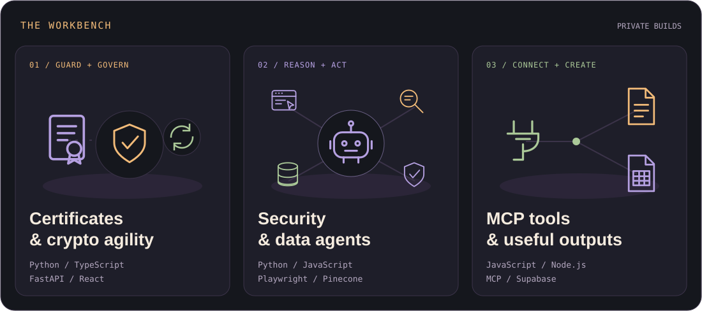
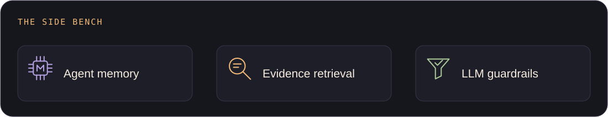

<!-- Generated from profile.json by scripts/render_profile.py. -->

<picture data-panel="workshop">
  <source media="(prefers-color-scheme: light)" srcset="assets/workshop-light.svg">
  
</picture>

<picture data-panel="projects">
  <source media="(max-width: 600px) and (prefers-color-scheme: light)" srcset="assets/projects-mobile-light.svg">
  <source media="(max-width: 600px)" srcset="assets/projects-mobile-dark.svg">
  <source media="(prefers-color-scheme: light)" srcset="assets/projects-light.svg">
  
</picture>

<picture data-panel="languages">
  <source media="(max-width: 600px) and (prefers-color-scheme: light)" srcset="assets/languages-mobile-light.svg">
  <source media="(max-width: 600px)" srcset="assets/languages-mobile-dark.svg">
  <source media="(prefers-color-scheme: light)" srcset="assets/languages-light.svg">
  
</picture>

<picture data-panel="toolkit">
  <source media="(max-width: 600px) and (prefers-color-scheme: light)" srcset="assets/toolkit-mobile-light.svg">
  <source media="(max-width: 600px)" srcset="assets/toolkit-mobile-dark.svg">
  <source media="(prefers-color-scheme: light)" srcset="assets/toolkit-light.svg">
  
</picture>

<picture data-panel="experiments">
  <source media="(max-width: 600px) and (prefers-color-scheme: light)" srcset="assets/experiments-mobile-light.svg">
  <source media="(max-width: 600px)" srcset="assets/experiments-mobile-dark.svg">
  <source media="(prefers-color-scheme: light)" srcset="assets/experiments-light.svg">
  
</picture>

Text version &amp; data notes

**AI agents. Security systems. Useful tools.**

I build agentic AI systems, data-protection workflows, and the tools that connect them. My work spans Python backends, TypeScript interfaces, retrieval pipelines, and browser automation.

**Certificate management and crypto agility** — Bringing certificate management, cryptographic assessment, and AI-assisted operations into one platform, with a Python API and a React interface.

`Python` · `TypeScript` · `FastAPI` · `React`

**Agents for security and data protection** — LLM-guided browser exploration, retrieval-backed security assistants, and role-aware data protection workflows. I work on the path from finding evidence to taking a useful next step.

`Python` · `JavaScript` · `Playwright` · `Pinecone`

**MCP tools with tangible outputs** — Tools that turn an agent's work into Word reports and Excel workbooks, with file delivery through cloud storage. Small interfaces that make automation useful beyond the chat window.

`JavaScript` · `Node.js` · `MCP` · `Supabase`

| Language | Share of detected bytes |
| --- | ---: |
| Python | 60.0% |
| TypeScript | 24.2% |
| CSS | 4.8% |
| JavaScript | 3.4% |
| HTML | 3.3% |
| Other | 4.3% |

Snapshot: **2026-11-16** · **17 selected private repositories**. Shares are GitHub-detected bytes, not proficiency or time spent. Similar code across repositories can be counted more than once. Small languages are grouped as Other. Percentages are rounded.

**Tools:** FastAPI, React, Playwright, MCP, LangChain, CrewAI, Pinecone, Supabase

- Exploring memory and knowledge sharing across agent crews.
- Building retrieval pipelines for regulatory framework evidence.
- Experimenting with LLM guardrails for sensitive input and prompt injection.

[Static cover](assets/workshop-static-dark.svg) · [Light static cover](assets/workshop-static-light.svg)

